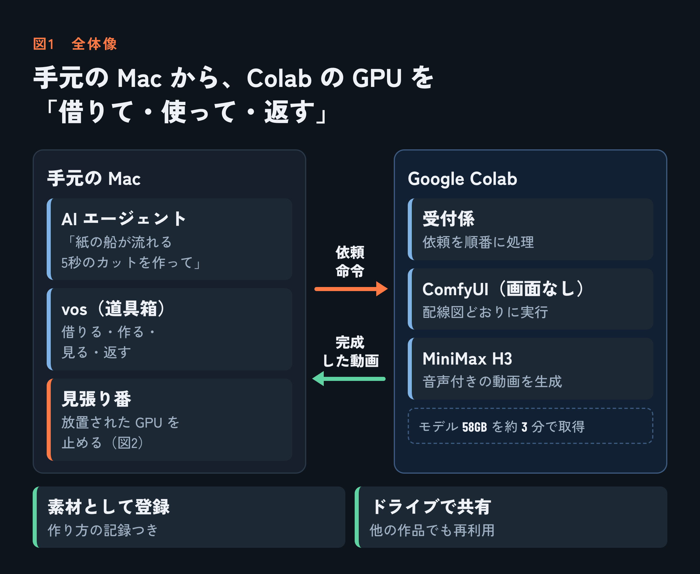
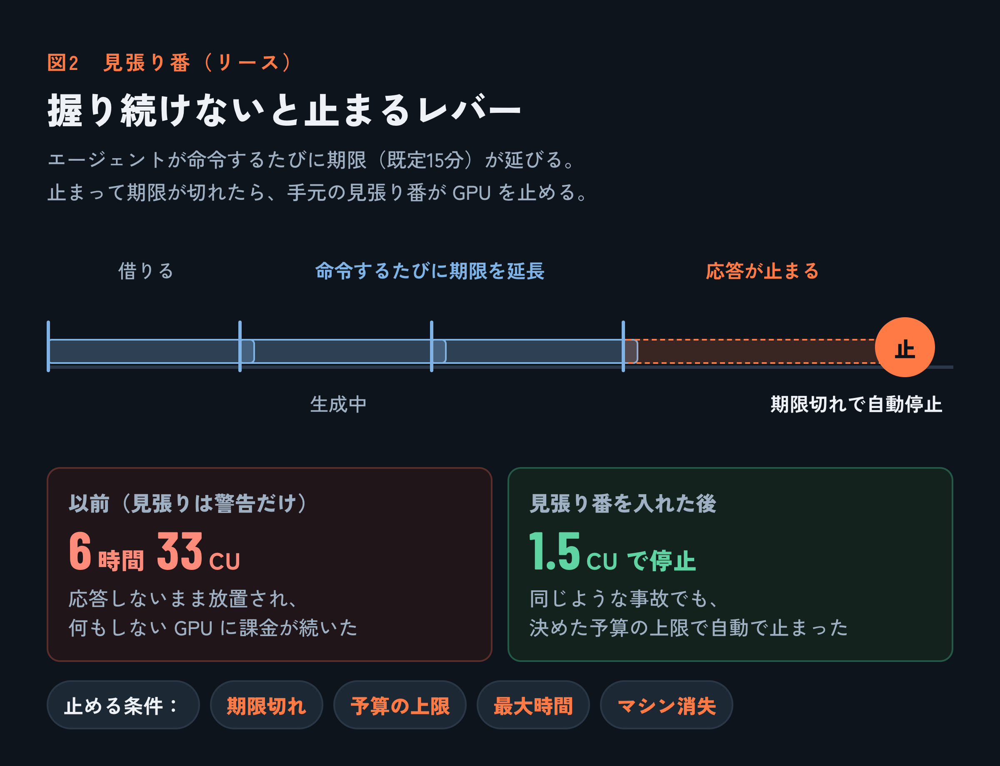
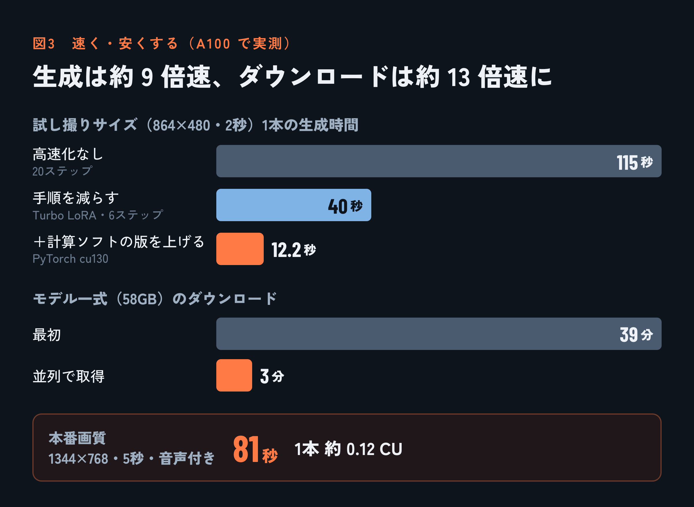
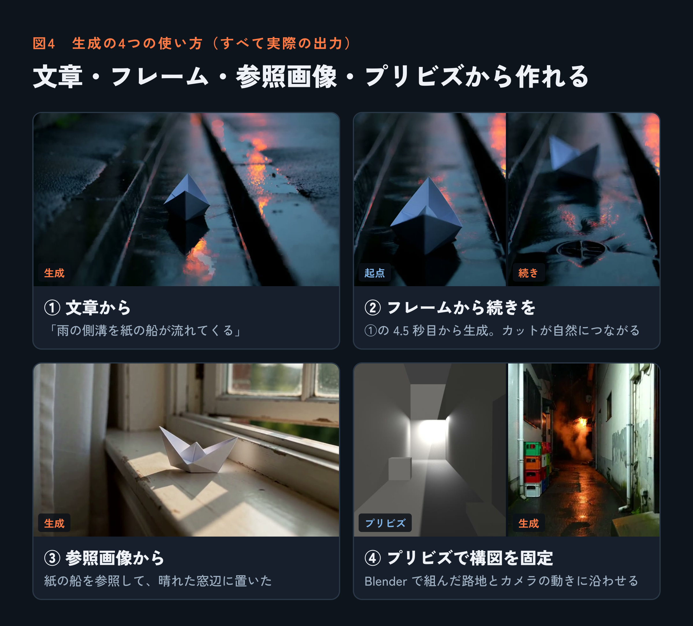

# AIエージェントに「借りたGPU」で映像を作らせる ― Colab上のComfyUIを道具にした話


映像編集を手伝う AI エージェントに、こう頼めるようにしました。

> 「雨の側溝を紙の船が流れてくる、5秒のカットを作って」

頼まれたエージェントは、次の流れを自分でこなします。

1. Google Colab の高性能 GPU（A100）を借りる
2. ComfyUI で動画生成モデル MiniMax H3 を動かし、映像を作る
3. できた動画を手元のプロジェクトに取り込む
4. フレームを見て、頼まれた内容どおりか確かめる
5. GPU を返す

この間、人がブラウザを開く場面はありません。カバーの紙の船も、この仕組みで実際に生成した映像の1コマです。

作ったものは、映像編集ツールキット **video-os-next** の一部として GitHub で公開しています（記事の最後で紹介します）。この記事では、プログラミングを知らない人にも伝わるように、どうやって実現したかを説明します。

ちなみに、私が決めたのは方針と予算、そして「どれから作るか」の順番です。設計、実装、実機での検証は、AI エージェント（Claude）に任せました。途中の失敗も含めて、その過程を書いています。

## 登場人物

* **AI エージェント**：映像編集を手伝う AI の助手です。コマンドを打って道具を使います。
* **vos**：エージェント用の道具箱です。映像編集のコマンドがそろっています。
* **Google Colab**：Google の「時間貸しの作業場」です。高価な GPU を1時間単位で借りられます。
* **ComfyUI**：画像や動画を生成するソフトです。部品（ノード）を線でつないで、処理の流れを組みます。
* **MiniMax H3**：文章や画像から、音声付きの動画を作る生成モデルです。
* **CU（コンピューティングユニット）**：Colab の料金の単位です。A100 は1時間あたり 5.30 CU かかります。

## なぜ、そのままでは使えなかったのか

Colab も ComfyUI も、**人がブラウザで操作する前提**で作られています。エージェントに使わせるには、4つの壁がありました。

1. **Colab は画面で操作するもの**：ノートブックを開き、ボタンを押して GPU を割り当てます。
2. **ComfyUI も画面で操作するもの**：マウスでノードをつなぎ、「実行」を押します。
3. **借りている間は、ずっとお金がかかる**：生成していなくても、GPU を確保している限り課金されます。人なら「使い終わったから閉じよう」と気づけます。しかしエージェントが途中で止まると、誰も閉じません。
4. **モデルが巨大**：MiniMax H3 は一式で約 58 GB あり、借りるたびにダウンロードし直す必要があります。

全体像は、次の図のようになりました。



ここから、壁を1つずつ越えた方法を説明します。

## 仕組み1：Colab を「コマンドで借りる」

Colab には、ブラウザを使わずにコマンドで操作できる **`colab` コマンド**があります。

* GPU を借りる
* 借りたマシンで命令を実行する
* ファイルを送る・受け取る
* 返す

この4つが、すべてコマンドでできます。エージェントはコマンドを打つのが得意なので、「Colab を借りる」こと自体はこれでできるようになりました。

ただし、**Google ドライブを Colab につなぐ方法（マウント）は使いませんでした**。マウントには、人がブラウザで許可を押す手順があります。エージェントだけでは、そこで止まってしまうからです。

## 仕組み2：ComfyUI を「画面なし」で動かす

ComfyUI には、画面を使わずに「この配線図で生成して」と頼める窓口（API）があります。そこで、次の形にしました。

1. **配線図をデータにする**：ComfyUI 公式の MiniMax H3 テンプレートは、画面で使う形式で保存されています。これを、窓口に送れる形式に変換しました。
2. **Colab の中に「受付係」を置く**：借りたマシンの中で、小さなプログラムを動かします。受付係の仕事は次の3つです。
   * ComfyUI とモデルを準備する
   * エージェントから届いた依頼を順番に並べ、1つずつ ComfyUI に渡す
   * 完成した動画の場所を記録する
3. **手元からは「頼んで、受け取る」だけ**：エージェントは依頼を送り、完成を待って、動画を手元にダウンロードします。

エージェントが使うのは、次の数行のコマンドだけです。

```
vos gen up --budget-cu 2              # GPU を借りる（予算 2 CU まで）
vos gen clip --prompt "…" --as boat   # 動画を1本作り、boat という名前で登録
vos look boat                         # フレームを見て確かめる
vos gen down                          # GPU を返す
```

## 仕組み3：お金を守る「見張り番」

この取り組みで一番大事だったのが、ここです。きっかけは、**実際に起きた失敗**でした。

### 起きたこと

最初の計測では、予算を 30 CU と決めていました。ところが、Colab に送った命令が**応答しないまま約6時間止まり**、その間 GPU は何もせずに課金だけが続きました。結果は **40.8 CU**。予算を約 11 CU 超えてしまいました。

当時の見張りは「予算を超えそう」と警告するだけで、GPU を止める機能はありませんでした。しかも、その見張り自体も途中で止まっていました。

### 作った仕組み：「握り続けないと止まるレバー」

電車の運転台には、運転士が手を離すと自動でブレーキがかかる装置があります。同じ考え方を取り入れました。

* GPU を借りるときは、必ず**「リース」（期限つきの使用権、既定15分）**を付ける
* エージェントが命令を出すたびに、期限が延びる
* エージェントが止まったり、放置したりして期限が切れると、**手元の Mac にいる見張り番が GPU を止める**



見張り番は、期限切れのほかにも次の場合に GPU を止めます。

* **予算の上限に達したとき**：残高の減り方と「料金レート × 経過時間」の大きい方で判断します。残高の表示が遅れても止まります。
* **決めておいた最大時間を過ぎたとき**
* **借りていたマシンが消えたとき**

止めるときは「止めたつもり」で終わらせず、**割り当てが本当に消えたかまで確かめます**。どの記録にも載っていない「行方不明の GPU」を見つけて返す機能もあります。

### 効果

* GPU なしの安いマシンでリースを2分にして放置したところ、期限切れで自動停止しました。
* その後の本番テストで、不具合のせいで依頼が処理されない事故が起きました。しかし今度は、見張り番が **1.5 CU の予算上限で GPU を止めました**。

「エージェントがうまく動くこと」を前提にしませんでした。先に作ったのは、**うまく動かなかったときに損をしない仕組み**です。

## 仕組み4：速く、安くする

GPU は時間で課金されるので、速くなればそのまま安くなります。A100 で工夫を1つずつ試し、効果を測りました。



* **計算ソフト（PyTorch）の版を上げる**：1ステップが 5.38 秒から 1.14 秒になりました（約4.7倍速）。
* **高速化用の追加部品（Turbo LoRA）を使う**：生成の手順を20回から6回に減らせます。
* **計算を間引く（スパース attention）**：画面の中の「どこに注目するか」の計算を減らします。本番解像度で、さらに 25% 短くなりました。
* **モデルを並列でダウンロードする**：58 GB が 39 分から約3分になりました。

一番効いたのは、意外にも**ソフトの版を上げるだけ**の変更でした。Colab に最初から入っている版では、ComfyUI が高速な計算方法を使わず、遅い方法で計算していたのです。逆に、効きそうに見えて効果がなかった工夫もありました。数字は予想ではなく、すべて実測値です。

**結果として、本番画質（1344×768・5秒・音声付き）の動画1本が約81秒、費用は約 0.12 CU になりました。** 高速化の前後でフレームを見比べ、画質が崩れていないことも確かめています。

## 仕組み5：作った動画を「ちゃんとした素材」として扱う

生成して終わりにはせず、映像編集の素材として管理できるようにしました。

* **来歴を残す**：動画の横に小さな記録ファイルを置きます。中身は、プロンプト、乱数の種（seed）、モデルの版、GPU の種類、かかった時間と費用です。あとから「この映像はどう作ったのか」を確かめられます。
* **同じ依頼は作り直さない**：まったく同じ依頼が来たら、GPU を使わずに保存済みの動画を返します。
* **ドライブで共有する**：生成した動画は、Google ドライブの共有ライブラリにも自動で置かれます。別のプロジェクトでも、GPU を借りる前にまずここを探して再利用します。同期が途中のファイルは、中身を確かめたうえで使いません。
* **目で確かめる**：生成後、エージェントはフレームを見て、頼まれた内容どおりか確かめます。どのテイクを採用するかは、人が決めます。

## できるようになったこと

生成の方法は4通りあります。次の図の画像は、どれも実際に生成したものです。



* **① 文章から**：プロンプトだけで生成します。
* **② フレームから続きを**：既にある素材の「○秒目のフレーム」を起点に、続きを生成します。カットがなめらかにつながります。
* **③ 参照画像から**：キャラクターや画風の参照画像を渡して生成します。
* **④ プリビズで構図を固定**：Blender で空間とカメラの動きを組み、その奥行き情報で生成を導きます。

仕上げとして、タイムラインで実際に使った動画だけを、最後にまとめて高解像度にする機能もあります。これは安い T4 GPU で動き、1本あたり約 0.06 CU です。

ここに、テロップや演出、BGM のビート合わせ、音量の調整などを組み合わせて、1本の映像に仕上げられます。

## あえてやらなかったこと

* **Google ドライブのマウント**：人の操作が必要で、エージェントだけでは完結しないためです。モデルは毎回、AI モデルの配布サイト（Hugging Face）から直接ダウンロードします。3分で終わるので、ドライブに置く必要もありませんでした。
* **ComfyUI の画面を外部に公開すること**：URL を知っている人なら、誰でも GPU を使えてしまうためです。
* **根拠のない数字を信じること**：「○秒で生成できる」といった事前の見込みは、すべて実測で確かめ直しました。

## 費用と、まだ残っている課題

* 開発と検証の全体で、残高は **200 CU から 147 CU** に減りました。このうち約 11 CU は、最初の放置事故による超過分です。
* マシンの準備には、ふだん約5分かかります。一度だけ、ダウンロードが遅くて17分かかったこともあります。借りるたびにこの準備が要るので、**生成はまとめて頼むほうが得**です。
* 参照画像への似せ方には限界があります。特徴的な形は、ありふれた形に寄りがちでした。
* **初めて触るエージェントが説明書だけを頼りに、1本の作品を最後まで作れるか**は、まだ試していません。

## リポジトリ：video-os-next

今回の仕組みは、映像編集ツールキット **video-os-next** に入っています。

**https://github.com/mocchalera/video-os-next**

video-os-next の考え方は「**編集者は AI モデル。システムは、目・記憶・手・検証を渡す道具箱**」です。AI エージェントが素材を見て、探して、タイムラインを組み、書き出した結果を自分で確かめ、最後の判断を人に返す。そのための道具がそろっています。

* **見る・探す**：フレームの一覧、映像の内容説明、言葉での素材検索
* **組む**：タイムライン（`timeline.json`）1つで、カット・音・テロップ・演出をまとめて管理
* **確かめる**：書き出した映像を検査し、問題を時刻つきで指摘
* **音**：ビート解析、文字起こし、音量の自動調整
* **生成**：今回紹介した `vos gen`（Colab の GPU で MiniMax H3 を動かす）

今回の仕組みの中身は、次の場所にあります。

* `src/gen/`：`vos gen` の本体
* `python/colab_gen_vm.py`：Colab の中で動く受付係
* `scripts/colab/`：見張り番
* `scripts/colab/spike/RESULTS.md`：速度計測の記録と、失敗の経緯

使うには、次の準備が必要です。

* Node.js 24
* ffmpeg
* `colab` コマンド（`pip install google-colab-cli`）
* A100 を借りられる Colab の有料プラン（コンピューティングユニット）
* プリビズを使う場合は Blender

動作を確認しているのは macOS だけです。個人で作っているプロジェクトなので、使うときは自己責任でお願いします。ライセンスは MIT です。

## まとめ

ポイントは3つです。

1. **画面前提の道具を、コマンドとデータで扱える形に包んだ**：Colab は `colab` コマンドで、ComfyUI は API と受付係で操作します。
2. **失敗しても損をしない仕組みを、先に作った**：リース、予算上限、確実な停止の3つです。実際の失敗から生まれました。
3. **速さと品質は実測で決めた**：1本約81秒・約 0.12 CU まで下げました。

これで AI エージェントは、「高価な GPU を必要なときだけ借りて、映像を作り、きちんと返す」ことができるようになりました。残る大きな確認は、初めて触るエージェントに短い作品を1本まるごと任せられるかどうかです。
